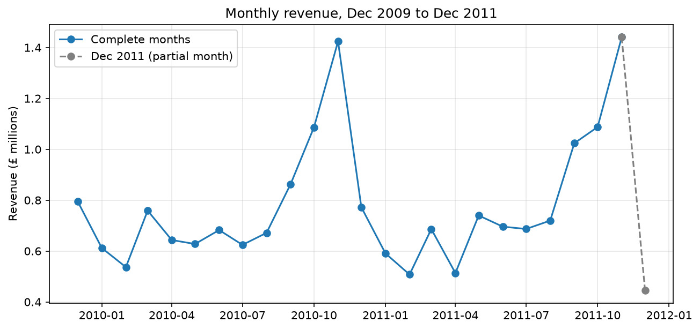
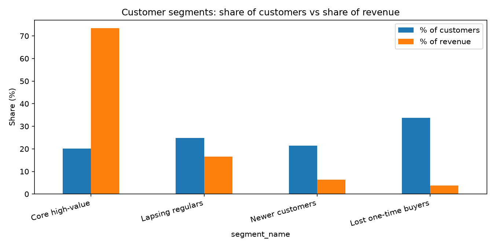

# Online Retail II: sales, customers and returns

An analysis of two years of transactions from a UK online gift retailer (1 December 2009 to 9 December 2011, about 1.07 million rows), using Python, SQL (SQLite) and Git. It cleans the raw data, builds a relational database, answers business questions with SQL, segments customers with K-means, and measures the effect of returns.

## Key findings

**Sales**
- Revenue after cleaning is £19.2M. It is strongly seasonal, peaking in November in both years (£1.42M in 2010, £1.44M in 2011) and dipping every February. January to August revenue is flat year on year (-0.3%); September to November grew 5.3%.
- The UK provides 85.3% of revenue. EIRE (3.2%), the Netherlands (2.9%), Germany (2.0%) and France (1.6%) follow.
- The Netherlands and EIRE are dominated by very few accounts. One customer provides 96% of Dutch revenue, and one provides roughly half of Irish revenue (49% to 55%). Their high average order values reflect individual accounts, not market-wide behaviour.

**Customers (RFM segmentation, K-means, k = 4)**
- 5,849 customers have an ID, covering 86.6% of revenue.
- Revenue is highly concentrated. The core high-value segment (20% of customers) provides 73% of identified revenue, and the top 117 customers (2% of all customers) provide about 38%.
- The largest segment by headcount (34% of customers) is lost one-time buyers: they typically bought once, last purchased about 13 months before the data ends, and provide 4% of revenue.

| Segment | Customers | Median recency (days) | Median orders | Median spend | % of revenue |
|---|---|---|---|---|---|
| Core high-value | 1,175 | 16 | 13 | £4,893 | 73% |
| Lapsing regulars | 1,454 | 180 | 5 | £1,455 | 17% |
| Newer customers | 1,249 | 24 | 3 | £716 | 6% |
| Lost one-time buyers | 1,971 | 401 | 1 | £273 | 4% |

**Returns**
- Refunds after the first day total £359,211, which is 1.9% of sales revenue. Typical monthly rates are 1.1% to 2.6%, with no post-Christmas surge.
- April 2011 (6.2%) is almost entirely one invoice: without it the month is 1.7%. The same customer placed an identical order minutes later, which suggests re-entry rather than a true return (the data cannot confirm this).
- Spain, Denmark and France show high refund rates (13.3%, 6.0%, 5.3%), but each is driven by one customer. Without that customer the rates are 0.7%, 1.3% and 1.2%, below the UK's 1.8%.
- Lapsing regulars have the highest segment refund rate (3.2%, or about 2.35% without the April invoice) against 1.9% for the core segment, a small difference.

## Data

[Online Retail II](https://archive.ics.uci.edu/dataset/502/online+retail+ii), Daqing Chen, UCI Machine Learning Repository, licensed CC BY 4.0. The data is not included in this repository: download it and place the Excel file in a `data/` folder.

## Method

- **Cleaning** (`notebooks/01_load_and_clean.ipynb`): exact duplicates dropped; cancellations held separately; non-product codes (postage, fees, adjustments) excluded; zero or negative prices excluded; orders reversed by an exact matching cancellation within one day excluded (1,405 lines, £404,143); prices over 50 times a product's median excluded as likely errors. Rows without a customer ID are kept for sales analysis and excluded for customer analysis.
- **SQL** (`notebooks/02_sql_analysis.ipynb`, `sql/`): the flat table is split into `customers`, `products`, `invoices` and `invoice_lines` in SQLite, with queries using joins and aggregation.
- **Segmentation** (`notebooks/03_rfm_segmentation.ipynb`): recency, frequency and monetary value, log-transformed and standardised, clustered with K-means implemented in NumPy. k = 4 was chosen as a local silhouette peak (0.366), with no sharp elbow in inertia. Five reruns with different seeds gave identical groupings (adjusted Rand index 1.0).
- **Returns** (`notebooks/04_returns_analysis.ipynb`): refunds by month, country and segment, with concentration checks.

## Limitations

- "First purchase" means first purchase in the data. December 2011 covers only 9 days.
- Silhouette scores of 0.30 to 0.44 indicate overlapping groups, so the segments are a practical partition of a continuum, not natural categories.
- Refund rates compare refunds with sales in the same period, not with the specific sales returned, and small countries reflect individual accounts.
- Customers without an ID (13.4% of revenue) cannot be segmented, and reversals can only be matched when an ID exists.

## Reproducing

1. Install the packages in `requirements.txt`.
2. Place the downloaded Excel file in `data/`.
3. Run the notebooks in order, 01 to 04. The `data/` folder and the database file are not tracked by Git.

## Tools

Python (pandas, NumPy, matplotlib), SQL (SQLite), Git, Jupyter.
